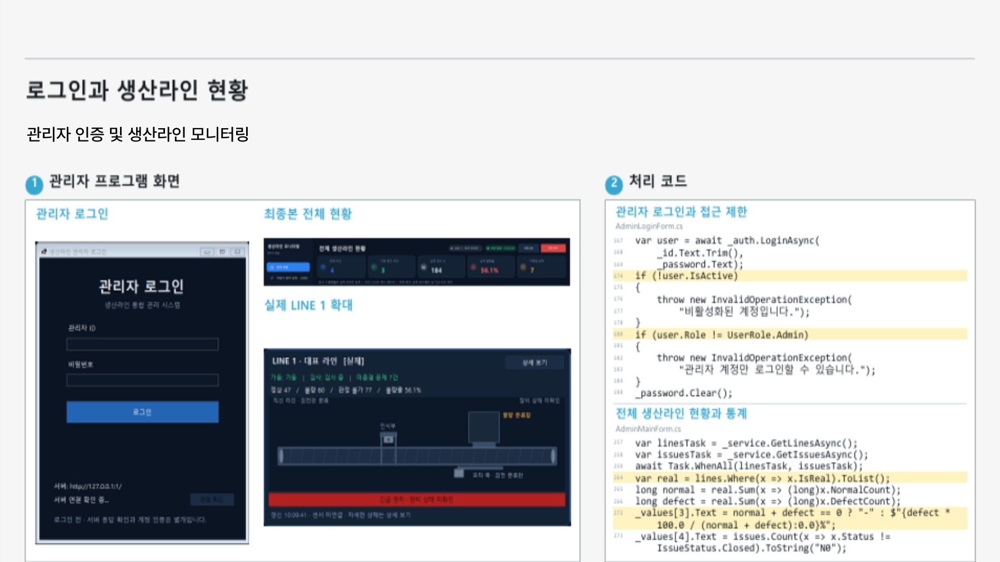
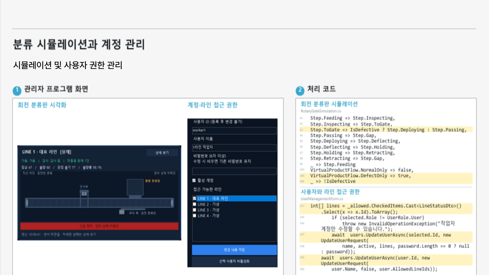
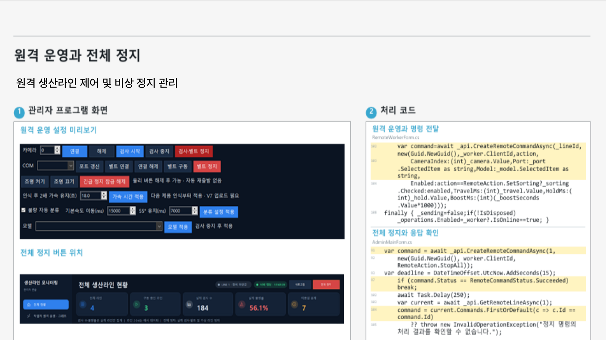
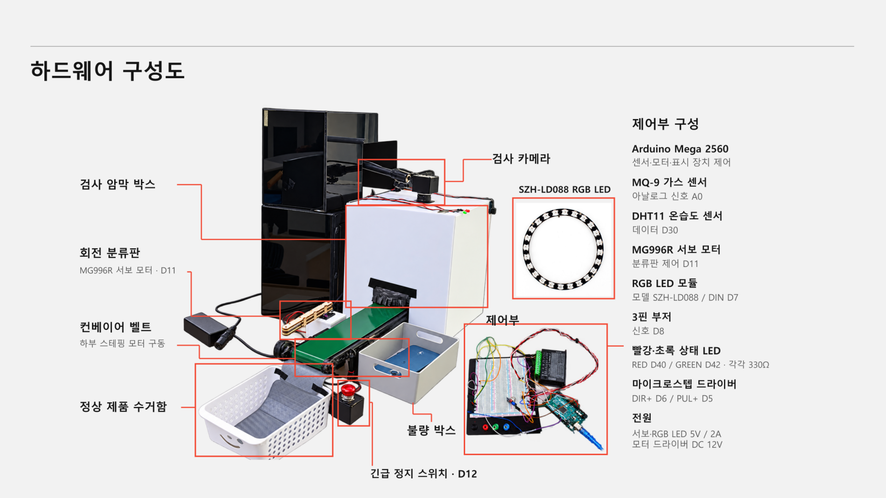
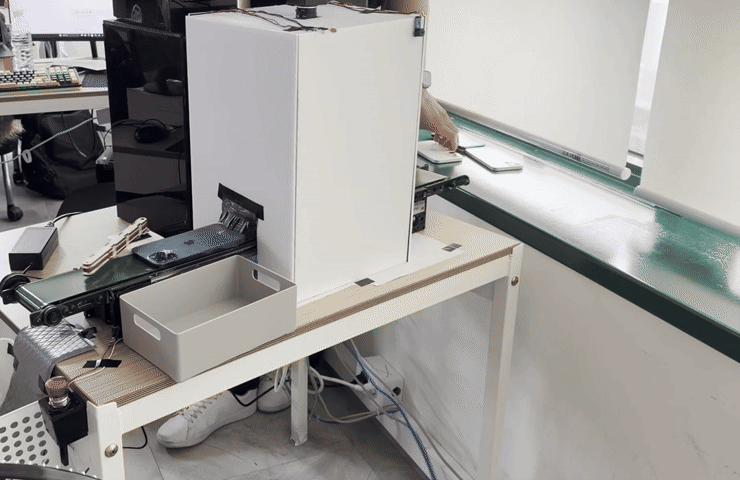
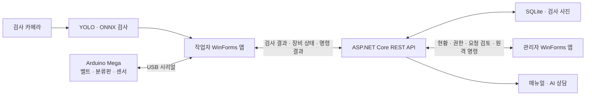

# 생산라인 통합 모니터링 및 채팅 | 2차 팀프로젝트

**컨베이어 위 휴대폰을 검사하고, 관리자와 작업자가 검사 결과·장비 상태·조치 이력을 함께 확인하는 시스템입니다.** 실제 장비를 사용하는 LINE 1과 동작을 시각화하는 가상 LINE 2~4를 한 화면에 표시합니다.


[조영준의 구현 기여](#조영준의-구현-기여) · [하드웨어 구성도](#하드웨어-구성도) · [시연](#시연) · [실행 방법](#실행-방법)

## 조영준의 구현 기여

**C# WinForms 관리자 앱에서 전체 생산라인 모니터링, 사용자 및 라인별 접근 권한 관리, 원격 장비 제어 UI를 구현했습니다.** 검사 이력과 사진을 조회하고, 문제의 완료 요청을 검토할 수 있도록 관리자 업무 흐름을 연결했습니다.

| 구현 영역 | 담당 내용 |
| --- | --- |
| 로그인과 통합 모니터링 | 활성 관리자 계정만 관리자 화면에 접근하도록 처리했습니다. 라인 현황과 문제 목록을 함께 조회하고, 실제 라인의 정상·불량 합계 및 불량률과 미종결 문제 수를 표시했습니다. |
| 분류 시뮬레이션과 계정 관리 | 정상 통과와 불량 분류를 회전판 상태 변화로 시각화했습니다. 작업자 계정을 등록·수정·비활성화하고 접근 가능한 라인을 지정하는 화면을 구현했습니다. |
| 원격 운영과 전체 정지 | 실제 LINE 1의 작업자 앱에 원격 명령을 전달하고 적용 상태를 조회하는 화면을 만들었습니다. 관리자 화면의 전체 정지는 작업자 앱이 보낸 처리 결과를 확인하는 흐름으로 구현했습니다. |
| 완료 요청과 검사 이력 | 처리 사유를 입력받아 종결 또는 반려하고 목록을 갱신했습니다. 라인·날짜·판정에 따라 검사 이력을 조회하고 일별 통계를 표시했습니다. |
| 검사 사진과 채팅 | 검사 행을 선택해 해당 사진을 조회했습니다. 선택을 빠르게 바꿨을 때 이전 응답이 새 사진을 덮지 않도록 처리하고, 단체 채팅과 문제별 대화를 관리자 화면에 연결했습니다. |

### 로그인, 생산라인 현황, 사용자 권한





### 원격 제어, 완료 검토, 검사 사진



나머지 원본 화면과 처리 코드는 [완료 요청·검사 이력·사진·채팅 구현 상세](docs/ADMIN-IMPLEMENTATION.md)에서 볼 수 있습니다.

## 하드웨어 구성도



| 영역 | 팀 프로젝트 하드웨어와 역할 |
| --- | --- |
| 검사부 | 검사 암막 박스와 카메라에서 컨베이어 위 제품을 촬영합니다. |
| 이송과 분류 | 스테핑 모터와 마이크로스텝 드라이버가 벨트를 구동합니다. MG996R 서보가 회전 분류판을 움직여 제품을 분리합니다. |
| 제어부 | Arduino Mega 2560이 작업자 PC와 USB 시리얼로 연결됩니다. |
| 센서와 표시 | 구성도에는 MQ-9 가스 센서, DHT11 온습도 센서, RGB LED, 빨강·초록 상태 LED와 부저가 포함돼 있습니다. |
| 정지와 수거 | 현장 정지 스위치를 두고, 정상 제품 수거함과 불량 박스를 구분했습니다. |

[Arduino 펌웨어 소스](hardware/ConveyorYoloControl/ConveyorYoloControl.ino)

## 시연

[](demo/production-line-demo.mp4)

[실제 컨베이어 시연 영상 보기](demo/production-line-demo.mp4) · 제공된 팀 시연에서 검사 구역과 분류판이 보이는 장면을 발췌한 26초 무음 영상

## 시스템 흐름



| 폴더 | 역할 |
| --- | --- |
| [`01_AdminApp`](01_AdminApp/) | 관리자 로그인, 대시보드, 사용자 관리, 원격 운영, 이력과 완료 요청 검토 |
| [`02_UserApp`](02_UserApp/) | 작업자 화면, 카메라 검사, 문제 조치, 장비 통신 |
| [`00_Shared`](00_Shared/) · [`03_Server`](03_Server/) | 공통 API 계약, 인증과 권한, SQLite, 검사와 채팅 데이터 |
| [`04_Vision`](04_Vision/) · [`06_TrainingTool`](06_TrainingTool/) | 휴대폰 검출과 판정, 모델 선택 및 학습 도구 |
| [`05_AiAssistant`](05_AiAssistant/) | 장비 매뉴얼 기반 상담 및 선택적 외부 AI 연동 |
| [`hardware`](hardware/) | Arduino 펌웨어와 하드웨어 의존 코드 |

## 실행 방법

Windows에서 **.NET 8 SDK와 .NET 8 Desktop Runtime**을 준비합니다. Visual Studio에서도 [`ProductionLineSystem.sln`](ProductionLineSystem.sln)을 열어 빌드할 수 있습니다.

### 1. 처음 실행할 때 시연 계정 설정

저장소 루트에서 PowerShell 7을 열고 아래를 실행합니다. 각 비밀번호는 새 값으로 12자 이상 설정합니다. 서버는 새 SQLite DB를 준비할 때 이 값으로 `admin`과 `worker1` 계정을 만들고, 이후에는 DB에 저장된 계정을 사용합니다.

```powershell
$env:PRODUCTIONLINE_ADMIN_PASSWORD = Read-Host '관리자 초기 비밀번호' -MaskInput
$env:PRODUCTIONLINE_WORKER_PASSWORD = Read-Host '작업자 초기 비밀번호' -MaskInput
dotnet build ProductionLineSystem.sln
dotnet run --project 03_Server/ProductionLine.Server --no-launch-profile
```

### 2. 관리자·작업자 앱 연결

별도 터미널에서 해당 앱을 실행하고 연결 창에 `http://127.0.0.1:5050`을 입력합니다. 처음에는 한 PC에서 접속해 가상 라인과 화면을 확인할 수 있습니다.

```powershell
dotnet run --project 01_AdminApp/ProductionLine.AdminApp
dotnet run --project 02_UserApp/ProductionLine.UserApp
```

실제 LINE 1 검사와 원격 제어는 작업자 앱, 카메라와 Arduino 장비가 연결된 환경에서 확인합니다. 작업자 앱에서 펌웨어 업로드 기능을 사용하려면 [Arduino CLI 패키지 정보](tools/arduino-cli/provenance.json)에 맞춰 `arduino-cli.exe`를 `tools/arduino-cli/`에 배치한 뒤 다시 빌드합니다.

공개본은 서버 기본 주소를 루프백으로 설정하고, 초기 비밀번호를 환경 변수에서 읽습니다. 앱 소스와 학습된 ONNX 모델, Arduino 펌웨어를 포함하며 운영 DB와 로컬 설정은 별도입니다.

## 검증

- 전체 솔루션 빌드에서 오류와 경고가 없었습니다.
- 임시 SQLite DB에서 설정한 초기 비밀번호로 관리자와 작업자 로그인을 확인했습니다.
- 원격 명령 상태, 정지 응답, 컨베이어·센서 통신 처리는 모의 장치로 검증했습니다. 실제 하드웨어 장면은 팀 시연 영상에서 확인할 수 있습니다.
