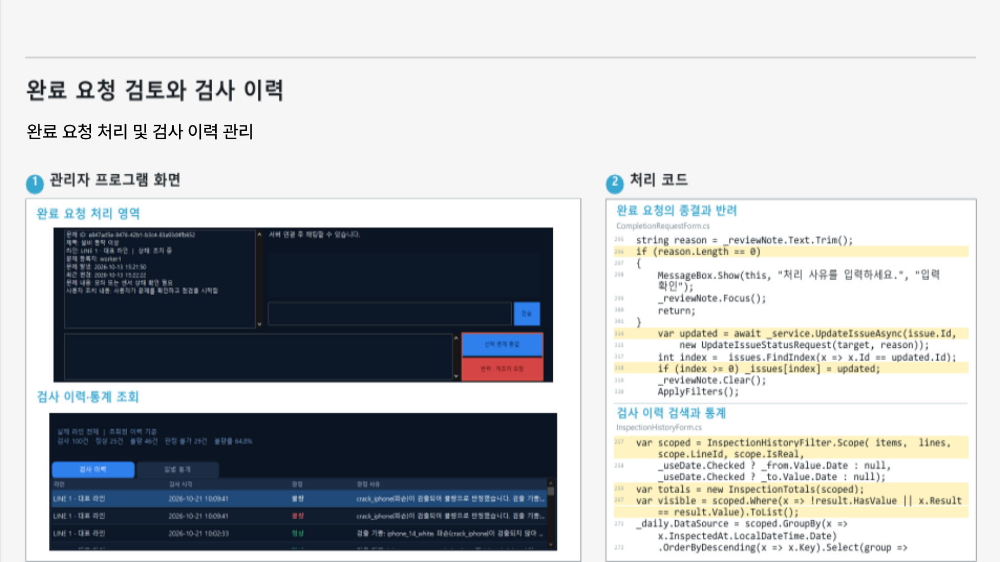
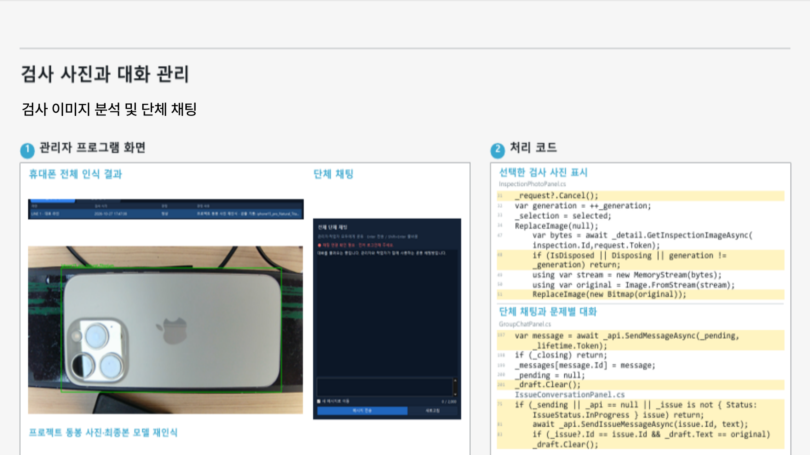

# 조영준 | WinForms 관리자 앱 구현

## 생산라인 모니터링과 권한 관리

- [`AdminLoginForm.cs`](../01_AdminApp/ProductionLine.AdminApp/AdminLoginForm.cs)는 로그인 응답의 활성 상태와 관리자 역할을 확인합니다.
- [`AdminMainForm.cs`](../01_AdminApp/ProductionLine.AdminApp/AdminMainForm.cs)는 라인과 문제 목록을 함께 갱신합니다. 정상·불량 집계는 실제 라인으로 범위를 좁힌 뒤 계산합니다.
- [`UserManagementForm.cs`](../01_AdminApp/ProductionLine.AdminApp/UserManagementForm.cs)에서 선택한 라인 ID와 활성 상태를 서버에 전달합니다.
- [`RotaryGateSimulation.cs`](../01_AdminApp/ProductionLine.AdminApp/RotaryGateSimulation.cs)에서 투입, 검사, 분류판 도착, 통과 또는 우회, 복귀 단계를 시각화합니다.

## 원격 운영과 전체 정지

[`RemoteWorkerForm.cs`](../01_AdminApp/ProductionLine.AdminApp/RemoteWorkerForm.cs)에서 실제 LINE 1 작업자 앱의 장비 상태와 연결 상태를 표시합니다. 운영 명령을 보낼 때 대상 작업자 인스턴스를 지정하고, 관리자 앱에서 서버 상태를 다시 조회해 명령의 처리 결과를 표시합니다.

[`AdminMainForm.cs`](../01_AdminApp/ProductionLine.AdminApp/AdminMainForm.cs)의 전체 정지 버튼은 서버에 요청을 보낸 뒤 응답이 돌아왔는지 확인합니다. 화면에서는 소프트웨어 명령의 처리 결과를 보여 줍니다. 현장 정지 스위치는 하드웨어 구성도에 따로 표시되어 있습니다.

## 완료 요청과 검사 이력

[`CompletionRequestForm.cs`](../01_AdminApp/ProductionLine.AdminApp/CompletionRequestForm.cs)는 처리 사유를 확인한 뒤 종결 또는 반려 상태를 저장하고 목록을 갱신합니다. [`InspectionHistoryForm.cs`](../01_AdminApp/ProductionLine.AdminApp/InspectionHistoryForm.cs)는 조회 범위 안에서 검사 결과를 필터링하고 일별 통계를 표시합니다.

## 검사 사진과 대화

[`InspectionPhotoPanel.cs`](../01_AdminApp/ProductionLine.AdminApp/InspectionPhotoPanel.cs)는 새 검사 행을 선택할 때 이전 사진 요청을 취소합니다. 현재 행에 맞는 응답만 표시해 목록과 사진을 함께 볼 수 있게 했습니다. [`IssueConversationPanel.cs`](../01_AdminApp/ProductionLine.AdminApp/IssueConversationPanel.cs)는 조치 중인 문제의 대화를 연결하고, [`GroupChatPanel.cs`](../00_Shared/ProductionLine.ChatUI/GroupChatPanel.cs)는 단체 채팅을 처리합니다.
